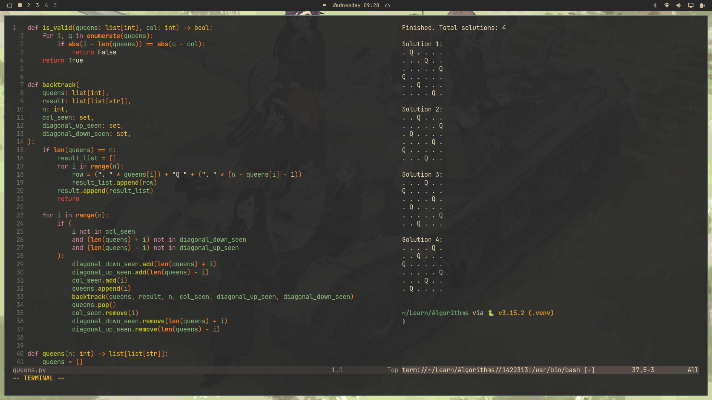

## Screenshot




# My Neovim Configuration

A minimal, fast, and highly personalized Neovim configuration built from scratch.

Designed for **Rust, Python, and Lua** development, with a custom Gruvbox theme, LSP support, autocomplete, and keyboard-driven navigation.

No LazyVim distribution — just `lazy.nvim` and plugins I've selected and configured myself.

## Features

| Plugin | Purpose |
|---|---|
| lazy.nvim | Plugin manager |
| gruvbox.nvim | Colorscheme with custom Python highlighting |
| nvim-treesitter | Syntax highlighting |
| nvim-lspconfig | Language server configurations |
| conform.nvim | Automatic formatting on save |
| blink.cmp | Toggleable autocompletion |
| oil.nvim | Editable filesystem explorer |
| fzf-lua | Fuzzy finding and project-wide search |
| flash.nvim | Fast cursor navigation |
| mini.surround | Surround text with quotes and brackets |
| mini.icons | File icons |
| which-key.nvim | Keybinding discovery |

Additional features include relative line numbers, language-specific indentation, clipboard yanking, and an integrated terminal split.

## Screenshot


## Installation

This configuration is designed for **Neovim 0.12+**, primarily on Arch Linux / Omarchy.

### 1. Install dependencies

On Arch Linux:

```bash
sudo pacman -S --needed \
  neovim git curl tar base-devel \
  tree-sitter-cli \
  fzf ripgrep fd \
  wl-clipboard \
  ruff stylua pyright
```

Install the Rust toolchain using [rustup](https://rustup.rs/) if it is not already available.

Then install Rust Analyzer and rustfmt:

```bash
rustup component add rust-analyzer rustfmt
```

If `rust-analyzer` is already installed through your system package manager, you can use that instead.

A Nerd Font is recommended for file icons.

### 2. Back up an existing Neovim configuration

If you already have a Neovim configuration, move it out of the way:

```bash
mv ~/.config/nvim ~/.config/nvim.backup
```

If the directory doesn't exist, skip this step.

For a completely fresh plugin installation, you can also back up your existing plugin data:

```bash
mv ~/.local/share/nvim ~/.local/share/nvim.backup
```

This is optional and preserves the old data rather than deleting it.

### 3. Clone the repository

```bash
git clone https://github.com/eliboi95/nvim-config.git ~/.config/nvim
```

### 4. Launch Neovim

```bash
nvim
```

`lazy.nvim` will bootstrap itself and install the configured plugins.

After installation, run:

```vim
:Lazy sync
```

Restart Neovim when installation finishes.

### 5. Verify everything

Inside Neovim:

```vim
:checkhealth
:checkhealth vim.lsp
:checkhealth nvim-treesitter
:ConformInfo
```

These commands help confirm that parsers, language servers, and formatters are available.

## Keybindings

The leader key is `Space`.

### File navigation

| Key | Action |
|---|---|
| `Space ee` | Open Oil file explorer |
| `Space ec` | Explore Neovim configuration |
| `Space ff` | Fuzzy find files |
| `Space fr` | Recent files |
| `Space sg` | Search text across project |
| `Space sb` | Search open buffers |

### Editing and navigation

| Key | Action |
|---|---|
| `Space j` | Flash jump |
| `Space J` | Flash Tree-sitter |
| `Space rn` | Rename symbol |
| `Space ca` | LSP code action |
| `gd` | Go to definition |
| `gr` | Find references |
| `K` | Hover documentation |
| `sa` | Add surrounding characters |
| `sd` | Delete surrounding characters |
| `sr` | Replace surrounding characters |

### Autocompletion

| Key | Action |
|---|---|
| `Ctrl + Space` | Toggle automatic suggestions |
| `Tab` | Accept selected suggestion |
| `Ctrl + N/P` | Navigate suggestions |
| `Enter` | Insert a newline |

Autocomplete starts disabled and can be enabled whenever needed.

### Terminal

| Key | Action |
|---|---|
| `Space t` | Toggle terminal split |
| `Esc Esc` | Leave terminal input mode |

### File management in Oil

| Key | Action |
|---|---|
| `a` | Add file or directory |
| `u` | Parent directory |
| `Enter` | Open file or directory |
| `q` | Close explorer |
| `:w` | Apply filesystem changes |

## Formatting

Formatting happens automatically when saving files.

| Language | Formatter | Indentation |
|---|---|---|
| Rust | rustfmt | 4 spaces |
| Python | Ruff | 4 spaces |
| Lua | StyLua | 2 spaces |

Lua formatting preferences are stored in `.stylua.toml`.

## Performance

Benchmarked on my Omarchy system using Hyperfine with 15 runs and 3 warmup runs.

| Configuration | Mean startup time | Memory |
|---|---:|---:|
| Custom Neovim | 47.5 ms | 19.2 MiB |
| Clean Neovim | 10.5 ms | 10.5 MiB |

Benchmark command:

```bash
hyperfine --warmup 3 --runs 15 \
  'nvim --headless +qa' \
  'nvim --clean --headless +qa'
```

These results measure headless startup, not full language-server initialization or editing performance.

## Updating

Update installed plugins inside Neovim:

```vim
:Lazy update
```

To pull configuration changes from GitHub:

```bash
cd ~/.config/nvim
git pull
```

To save and upload local changes:

```bash
cd ~/.config/nvim
git add .
git commit -m "Describe your changes"
git push
```

## Notes

- The Gruvbox theme includes custom Python syntax colors.
- Ghostty transparency and the desktop wallpaper are configured separately from Neovim.
- External language servers and formatters must be installed on each machine.
- `lazy-lock.json` is committed to help keep plugin versions reproducible.

Built from scratch, one plugin at a time. 🚀

